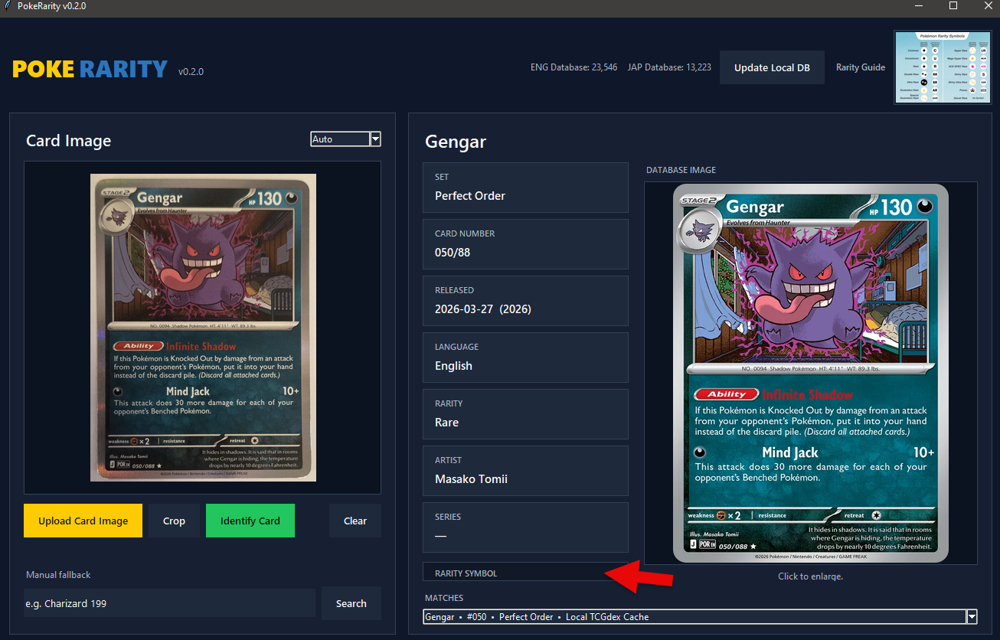

# PokeRarity

PokeRarity is a Windows desktop app for identifying Pokémon cards from a photo. It uses local OCR plus a locally cached card database to identify the card and display its set, collector number, release date, language, rarity, artist, rarity symbol, and matching database image.



> Current version: **v0.2.3**

## Features

- Local OCR using RapidOCR/OpenCV
- English and Japanese card support
- Local-first SQLite card database
- Automatic database update check when the app starts
- Manual **Update Local DB** button remains available
- Displays separate ENG and JAP database totals
- Displays **Last checked** and **Last updated** timestamps
- Card-name and collector-number matching based on the PokeScan lookup pipeline
- Rarity-symbol display that follows the included ENG/JAP rarity guide
- Interactive image crop tool
- Stop/cancel button while scanning
- Candidate selector for ambiguous matches
- Clickable database card image
- Clickable rarity-reference guide
- Optional PyInstaller Windows build

## Quick start — Windows EXE (recommended)

1. Open the [v0.2.3 release page](https://github.com/ATOMNFT/PokeRarity/releases/tag/v0.2.3).
2. Download [PokeRarity-Windows-v0.2.3-EXE.zip](https://github.com/ATOMNFT/PokeRarity/releases/download/v0.2.3/PokeRarity-Windows-v0.2.3-EXE.zip) under **Assets**.
3. Right-click the downloaded ZIP and choose **Extract All**. Extract it to a normal folder.
4. Open the extracted folder and double-click `PokeRarity.exe` (open the `PokeRarity` subfolder first if present).

Keep all extracted files and folders together. Do not run the EXE inside the ZIP or move it away from its bundled files.

No Python installation or `setup.bat` is required for the EXE build. GitHub's **Source code (zip)** and **Source code (tar.gz)** downloads are for the source installation below.

## Source installation — Python

Use this option if you want to run or modify the Python source.

### 1. Download

Download the source ZIP from the latest GitHub Release, extract it to a normal folder, and open that folder.

### 2. Run setup

Double-click:

```text
setup.bat
```

Setup will:

1. Check for Python 3.12.
2. Offer to install Python 3.12 through `winget` if it is missing.
3. Create a private `.venv` environment.
4. Install the required Python packages.
5. Download and build the local Pokémon card database.

### 3. Start PokeRarity

Double-click:

```text
run.bat
```

For a console-free launch after setup, use:

```text
run_silent.bat
```

## Using PokeRarity

1. Click **Upload Card Image**.
2. Choose **Auto**, **English**, or **Japanese**.
3. Crop the image first if the card occupies only part of the photo.
4. Click **Identify Card**.
5. Review the matched card information and rarity symbol on the right.
6. Click the database card image to enlarge it.

Straight-on photos with a sharp card name and collector number generally give the best results.

## Local card database

PokeRarity identifies cards against a local SQLite cache built from the public TCGdex `cards-database` project.

When PokeRarity starts, it checks the upstream repository in the background. If the database revision has changed, PokeRarity rebuilds the local cache automatically. If there is no change, the existing cache is left alone.

You can also force a refresh at any time with **Update Local DB**.

Runtime database files are stored under `cache/` and are intentionally excluded from Git so every installation maintains its own local cache.

## Network use

OCR and primary card matching are local after setup. Internet access is used for:

- the initial local database build,
- automatic/manual database update checks,
- downloading a newer database snapshot when available,
- database card images and optional online enrichment when available.

If an update check cannot connect, PokeRarity continues using the existing local database.

## Build a Windows app folder

After running `setup.bat`, double-click:

```text
build_exe.bat
```

PyInstaller will create the packaged application under:

```text
dist\PokeRarity\
```

This is currently an onedir build rather than a single-file executable.

## Project structure

```text
PokeRarity/
├── app.py
├── local_cache.py
├── pokescan_lookup.py
├── pokescan_ocr.py
├── pokescan_parser.py
├── build_cache.py
├── requirements.txt
├── setup.bat
├── run.bat
├── run_silent.bat
├── build_exe.bat
├── assets/
│   └── Pokemon-Rarity-Symbols-Summary.jpg
├── docs/
│   └── app-screenshot.png
├── .github/
│   └── workflows/
│       └── python-check.yml
├── CHANGELOG.md
├── CONTRIBUTING.md
├── THIRD_PARTY_NOTICES.md
├── LICENSE
└── .gitignore
```

Generated folders such as `.venv/`, `cache/`, `build/`, `dist/`, `__pycache__/`, and log files are excluded by `.gitignore`.

## Troubleshooting

### The app cannot identify newer cards

Use **Update Local DB** and allow the database rebuild to finish.

### Setup cannot find Python 3.12

Install Python 3.12 x64 from Python.org or make sure Windows Package Manager (`winget`) is available, then run `setup.bat` again.

### A card does not match correctly

Try cropping closer to the card, avoid glare, and make sure the card name and collector number are sharp and readable.

### I need diagnostic information

Run `run.bat` instead of `run_silent.bat`. Runtime diagnostics are also written to `PokeRarity.log` locally; the log file is excluded from Git.

## Data and acknowledgements

PokeRarity uses card/set metadata from the open-source TCGdex cards database. See [THIRD_PARTY_NOTICES.md](THIRD_PARTY_NOTICES.md) for attribution and dependency information.

## Disclaimer

PokeRarity is an unofficial fan-made project. It is not affiliated with, sponsored by, or endorsed by The Pokémon Company, Nintendo, Creatures Inc., GAME FREAK, or TCGdex.

Pokémon names, card artwork, symbols, and related trademarks belong to their respective owners. Database card images are used for identification/reference purposes and are not included in this source repository except for the user-supplied rarity reference asset required by the application.

## License

The PokeRarity source code in this repository is released under the [MIT License](LICENSE). Third-party projects, data, packages, names, images, and other assets remain subject to their own licenses and terms.
